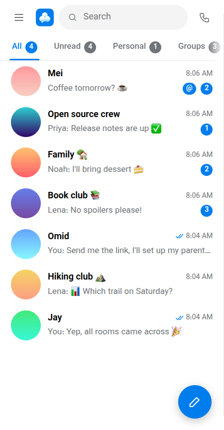
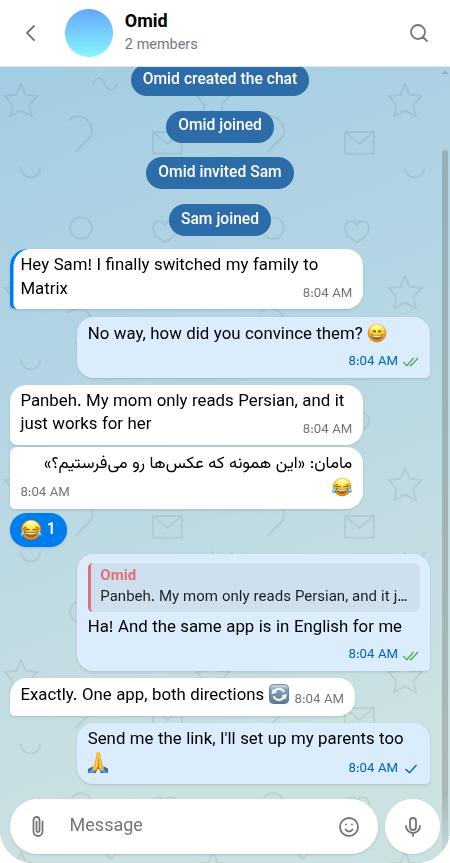
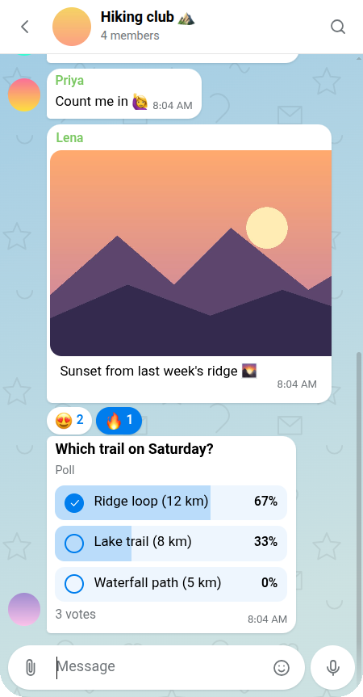

<div align="center">


# Panbeh

**A Persian-first Matrix client for Android, desktop and the web**

[](https://github.com/mhfmobin/panbeh-matrix-client/releases/latest) [](https://github.com/mhfmobin/panbeh-matrix-client/releases) 

[فارسی](README.md)

</div>

Most Matrix clients treat right-to-left languages as an afterthought: mirrored layouts that half work, mixed-direction messages that come out scrambled, search that misses words because of a letter variant. Panbeh (*پنبه*, "cotton") started from the other end. It's a Matrix client designed in Persian first, and it's just as much at home in English.

It's a full client, not a demo. It handles end-to-end encryption, group calls, threads, spaces and custom emoji, and it feels like the messaging apps people already know. It connects to any homeserver.

<p align="center">
  
  &nbsp;
  
  &nbsp;
  
</p>

## Highlights

- **Bidirectional by design.** Every message lays out in its own direction, so a Persian line in an English chat (or the reverse) reads correctly. The whole UI mirrors cleanly between the Persian and English layouts.
- **Notifications without Google.** On Android there's no Firebase and no push gateway. A foreground service keeps the client syncing, so notifications work on de-Googled phones and in places where Google services are unreliable. Because the client decrypts them itself, encrypted messages show their real text.
- **Calls that interoperate.** Voice and video use MatrixRTC over LiveKit, the same stack as Element Call and Element X, so you can call people on those apps.
- **Built for bad networks.** Sends queue offline and survive restarts. History and search work without a connection, and calls have a low-data mode.
- **One codebase, every platform.** React and matrix-js-sdk, wrapped with Capacitor for Android and Electron for Windows and Linux.

## Features

| Area | What you get |
| --- | --- |
| **Messaging** | Replies, threads, pins, forwarding, edits, markdown with a format bar, hashtags, drafts synced across devices |
| **Media** | Albums, a built-in photo editor, voice notes, round video messages, GIFs, static and live location |
| **Expression** | Apple emoji throughout, custom emoji and sticker packs ([MSC2545](https://github.com/matrix-org/matrix-spec-proposals/pull/2545)), jumbo emoji-only messages, reactions |
| **Calls** | 1:1 and group calls, screen sharing, picture-in-picture, raised hands, call history |
| **Security** | E2EE with cross-signing, QR and emoji verification, key backup, app lock with PIN or biometrics |
| **Groups** | Spaces, polls, roles and permissions, room upgrades, reporting, QR invite links |
| **Server-side extras** | Scheduled messages via delayed events ([MSC4140](https://github.com/matrix-org/matrix-spec-proposals/pull/4140)) where the homeserver supports them |

## Install

Grab a build from [Releases](https://github.com/mhfmobin/panbeh-matrix-client/releases/latest):

| Platform | File |
| --- | --- |
| Android 7+ | `Panbeh-<version>.apk` |
| Windows 10/11 | `Panbeh-windows-setup-<version>.exe` (per-user, no admin) |
| Linux | `Panbeh-linux-x86_64-<version>.AppImage` or `Panbeh-linux-amd64-<version>.deb` |

Desktop and Android builds update themselves from GitHub releases. The desktop apps aren't code-signed yet, so Windows SmartScreen will ask once (*More info* → *Run anyway*).

### Self-host the web app

```sh
docker compose up -d   # serves Panbeh on :8080
```

The image is a static build behind nginx. Point it at any homeserver from the login screen.

## Homeserver notes

Panbeh works with Synapse and the Conduit family (Conduit, Tuwunel, Continuwuity). Two features need server setup:

- **Calls** need a LiveKit SFU and lk-jwt-service. See [CALLS.md](CALLS.md).
- **Scheduled messages** need Synapse with `max_event_delay_duration` set. See [SERVER.md](SERVER.md).

## Development

```sh
npm install
npm run dev           # web app on http://localhost:5173
npm test              # node --test
npm run build         # type-check + production build
npm run desktop:dev   # Electron against the dev server
```

- `src/` holds the app, shared by all platforms. `src/native.ts` and `src/desktop.ts` are the only platform-specific parts.
- `android/` is the Capacitor project. See [ANDROID.md](ANDROID.md).
- `desktop/` is the Electron shell. See [DESKTOP.md](DESKTOP.md).
- UI strings live in `src/lang/fa.ts` and `src/lang/en.ts`. Persian is the source language.

Pushing a `v*` tag builds the APK and the desktop installers in GitHub Actions and attaches them to a release.
