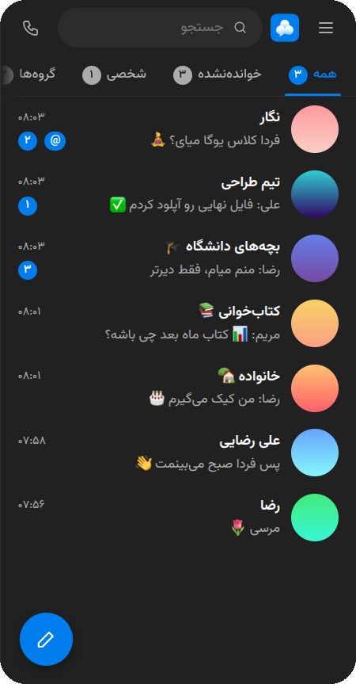
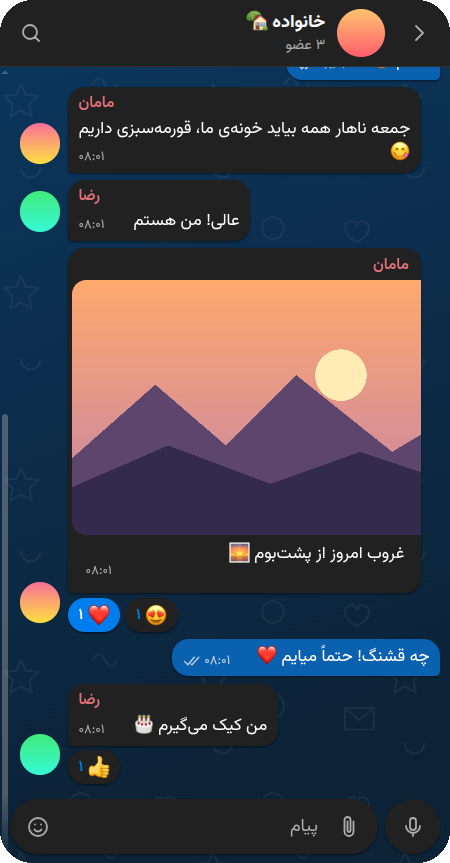
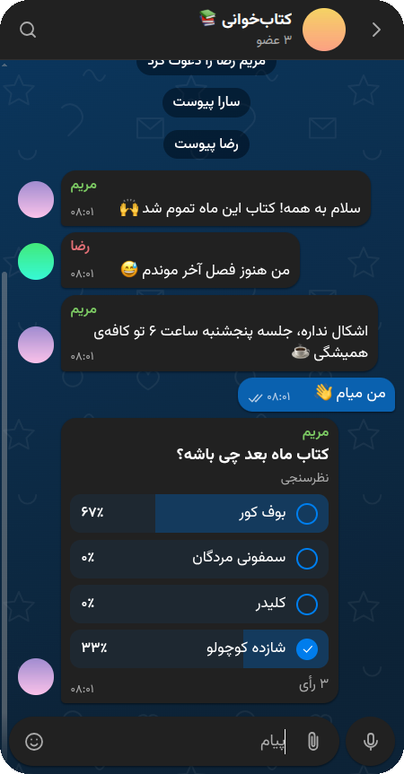

<div align="center">


# پنبه

**پیام‌رسانِ فارسی، روی شبکه‌ی آزاد ماتریکس**


[](https://github.com/mhfmobin/panbeh-matrix-client/releases/latest) [](https://github.com/mhfmobin/panbeh-matrix-client/releases) 

[English](README.en.md)

</div>

<div dir="rtl">

پنبه کلاینت [ماتریکس](https://matrix.org) برای فارسی‌زبان‌هاست. با پنبه می‌توانید به هر حساب ماتریکسی وصل شوید، روی هر سروری.

اگر با تلگرام کار کرده باشید، در پنبه غریبه نیستید. پیام را بکشید تا پاسخ بدهید، نگه دارید تا انتخاب شود، و گفتگوها را در پوشه‌ها مرتب کنید. فرقش این است که پنبه از روز اول برای فارسی ساخته شده، نه این‌که بعداً راست‌چین شده باشد.

<p align="center">
  
  &nbsp;
  
  &nbsp;
  
</p>

## چرا پنبه؟

- **فارسیِ درست.** همه‌چیز از پایه راست‌چین طراحی شده، با فونت وزیرمتن، تاریخ شمسی و اعداد فارسی. در جستجو هم «ي» و «ی» یا «ك» و «ک» فرقی ندارند و نیم‌فاصله مانع پیدا شدن کلمه نمی‌شود.
- **بدون سرویس‌های گوگل.** اعلان‌های اندروید به Firebase نیاز ندارند. خود برنامه در پس‌زمینه وصل می‌ماند و پیام‌ها را می‌گیرد، حتی پیام‌های رمزنگاری‌شده را با متن کاملشان.
- **گفتگوهای خصوصی.** رمزنگاری سرتاسری، تأیید دستگاه‌ها با کد QR یا مقایسه‌ی شکلک‌ها، و قفل برنامه با رمز یا اثر انگشت.
- **با اینترنت ضعیف کنار می‌آید.** اگر اتصال قطع شود، پیامتان گم نمی‌شود و در صف می‌ماند تا ارسال شود. تاریخچه و جستجو بدون اینترنت هم کار می‌کنند، و تماس‌ها حالت کم‌مصرف دارند.
- **مال خودتان.** کد باز است و می‌توانید نسخه‌ی وب را روی سرور خودتان بالا بیاورید.

## چه کارهایی می‌شود کرد؟

### 💬 گفتگو

پاسخ، رشته‌ی گفتگو (Thread)، سنجاق، هدایت پیام، ویرایش و حذف. پیام زمان‌بندی‌شده، هشتگ، و پیش‌نویسی که بین دستگاه‌هایتان همگام می‌ماند. متن را با مارک‌داون یا نوار قالب‌بندی، پررنگ و کج کنید.

### 😀 ایموجی و استیکر

ایموجی‌های اپل در همه‌جای برنامه، ایموجی و استیکر سفارشی برای خودتان یا برای هر گروه، و گیف. پیامی که فقط ایموجی باشد، بزرگ و بدون حباب نمایش داده می‌شود.

### 📸 عکس، صدا و ویدیو

آلبوم عکس و ویدیو، ویرایشگر عکس (برش، نقاشی، متن، استیکر، محو کردن)، پیام صوتی، ویدیوی گرد، و ارسال موقعیت ثابت یا زنده روی نقشه.

### 📞 تماس صوتی و تصویری

تماس دونفره و گروهی، اشتراک صفحه، تصویر در تصویر، و حالت کم‌مصرف برای اینترنت ضعیف. تماس‌های پنبه با Element X و Element Call هم کار می‌کنند.

### 👥 گروه و فضا

نظرسنجی، مدیریت اعضا و دسترسی‌ها، فضاها (Spaces) برای کنار هم گذاشتن گروه‌ها، و لینک و کد QR برای دعوت.

## دریافت

نسخه‌ها از صفحه‌ی [Releases](https://github.com/mhfmobin/panbeh-matrix-client/releases/latest) قابل دریافت‌اند:

| سیستم | فایل |
| --- | --- |
| اندروید ۷ به بالا | `Panbeh-….apk` |
| ویندوز ۱۰ و ۱۱ | `Panbeh-windows-setup-….exe` |
| لینوکس | `Panbeh-linux-x86_64-….AppImage` یا `Panbeh-linux-amd64-….deb` |
| وب | روی سرور خودتان؛ پایین‌تر را ببینید |

نسخه‌های اندروید و دسکتاپ خودشان به‌روز می‌شوند و بعد از هر به‌روزرسانی، تغییرات تازه را نشانتان می‌دهند.

برنامه‌های دسکتاپ هنوز امضای دیجیتال ندارند، برای همین بار اول هشدار می‌بینید. در ویندوز روی *More info* و بعد *Run anyway* بزنید.

### اعلان‌ها روی اندروید

پنبه برای اعلان‌ها از سرور واسط استفاده نمی‌کند. وقتی اعلان‌ها روشن باشند، برنامه یک اعلان دائمی «پنبه متصل است» نشان می‌دهد و در پس‌زمینه وصل می‌ماند. اگر پیام‌ها دیر می‌رسند، در تنظیمات ← اعلان‌ها گزینه‌ی «اجرای بدون محدودیت در پس‌زمینه» را بزنید. اگر برای صرفه‌جویی در باتری ترجیح می‌دهید، می‌توانید دریافت پیام را از حالت فوری به هر چند دقیقه یک‌بار تغییر دهید. جزئیات بیشتر در [ANDROID.md](ANDROID.md) است.

## برای مدیران سرور

پنبه با Synapse و خانواده‌ی Conduit (Tuwunel و Continuwuity) کار می‌کند. چند قابلیت به تنظیم سرور نیاز دارند:

- **تماس‌ها** به LiveKit نیاز دارند. راهنمای قدم‌به‌قدم در [CALLS.md](CALLS.md) است.
- **پیام زمان‌بندی‌شده** فقط روی Synapse و با یک خط تنظیم کار می‌کند: [SERVER.md](SERVER.md).

نسخه‌ی وب را با داکر روی پورت ۸۰۸۰ بالا بیاورید:

<div dir="ltr">

```sh
docker compose up -d
```

</div>

## ساختن از روی کد

یک کد برای هر سه بستر است: وب با React، اندروید با Capacitor، و دسکتاپ با Electron.

<div dir="ltr">

```sh
npm install
npm run dev            # http://localhost:5173
npm test
npm run desktop:dev    # Electron
```

</div>

ساخت اندروید در [ANDROID.md](ANDROID.md) و ساخت دسکتاپ در [DESKTOP.md](DESKTOP.md) توضیح داده شده است. نسخه‌ی رسمی هر بار با زدن تگ `v*` در GitHub Actions ساخته می‌شود.

---

<p align="center">پنبه ☁️</p>

</div>
